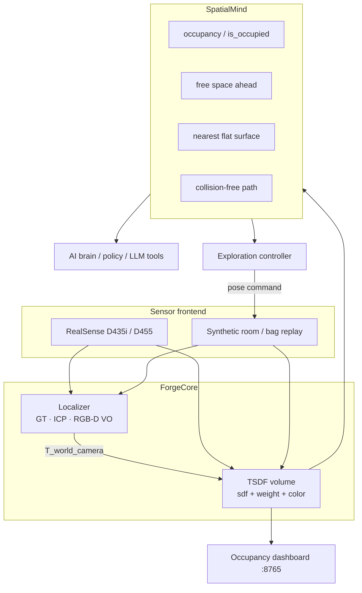

# SpatialForge

**A spatial foundation for machines that have to live in the real world.**

SpatialForge is a real-time 3D mapping and localization stack built for **edge hardware** — NVIDIA Jetson Orin Nano and Raspberry Pi 5 class computers — with an Intel RealSense (or a recorded/synthetic RGB-D stream) as the eye. It does not try to be a complete SLAM research platform. It tries to be the layer an **AI brain** can sit on: a live metric world model plus a small set of questions that actually matter when you move a body through a room.

> What is free in front of me? Is this point occupied? Where is the nearest flat surface? Give me a collision-free path to that crate.

The runtime is `ForgeCore`. The brain-facing API is `SpatialMind`.

---

## The problem

Companies building the “AI brain” for physical machines — warehouse AMRs, inspection arms, farm robots, security platforms — usually inherit one of two stacks:

1. **A SLAM library** that produces a pose and a pretty mesh, then leaves you to reinvent occupancy, clearance, and “is this table?” on top of a point cloud.
2. **A full robotics middleware** (ROS + nav2 + MoveIt + a perception zoo) that is correct, heavy, and hostile to a small team shipping an edge box.

Neither is a **spatial foundation**. A foundation is:

- dense enough to collide with,
- live enough to update at camera rate,
- queryable without writing another paper,
- small enough to run next to a VLM / policy on a Jetson.

SpatialForge is that layer. Mapping and tracking exist to keep `SpatialMind` honest.

---

## What this is *not*

SpatialForge is not a drop-in replacement for RTAB-Map, ORB-SLAM3, nvblox, or Open3D SLAM.

| | Typical SLAM toolkit | SpatialForge |
| --- | --- | --- |
| Primary output | Pose graph + reconstructed map | **Query API over a live volume** |
| Consistency | Global, loop-closed | Locally consistent, bounded AABB |
| Dependencies | Often ROS / CUDA kernels | NumPy + OpenCV; CUDA optional later |
| Who it serves | Mapping researchers, nav stacks | An AI brain / planner / tool-caller |
| Success metric | ATE / mesh beauty | “Can I ask the world a question in 1 ms?” |

Use a SLAM system when you need a city-scale, loop-closed trajectory. Feed its pose into ForgeCore if you want. The TSDF does not care who authored `T_world_camera`.

---

## System architecture



World frame is **z-up**. Camera frame is **OpenCV optical** (x right, y down, z forward). That combination is the usual robotics compromise: planners think on the floor, cameras think along the optical axis.

A longer walkthrough lives in [`docs/architecture.md`](docs/architecture.md).

---

## Quick start (simulation first)

You do not need a camera, a Jetson, or CUDA.

```bash
git clone https://github.com/spatialforge/spatialforge.git
cd spatialforge
python3 -m venv .venv
source .venv/bin/activate
pip install -e ".[dev]"
```

Build a map of the procedural room, track the camera, and serve a live occupancy view:

```bash
python scripts/run_mapping.py -c configs/simulation.yaml
```

Open [http://127.0.0.1:8765](http://127.0.0.1:8765). When the run finishes, `outputs/simulation/map.ply` is a colored surface cloud you can drop into MeshLab / CloudCompare / Open3D.

Ask the world questions:

```bash
python scripts/query_demo.py -c configs/simulation.yaml --no-viz
```

Example output:

```
=== SpatialMind query demo ===
camera at [1.417 1.189 1.128]
is_occupied(air [ 1.8 -1.6  0.9]) -> False
is_occupied(pillar [0.95 0.95 0.7 ]) -> True
free space from corner: min=2.00m  mean=2.00m  blocked=0%
nearest flat surface: [ 0.375 -2.375  0.225]  dist=1.75m
path [-2.28 -2.28] -> [1.38 1.08]: reachable=True  waypoints=80  length=5.21m
```

Frontier-driven exploration (the camera walks toward unknown space):

```bash
python scripts/run_exploration.py -c configs/simulation.yaml --frames 80
```

Replay a recording (synthetic `.npz` or Intel `.bag`):

```bash
python -c "from spatialforge.cli import record_synthetic; record_synthetic('data/synthetic_room.npz')"
python scripts/replay_bag.py --bag data/synthetic_room.npz --no-viz
```

Tests:

```bash
pytest -q
```

---

## Real hardware

**Primary:** Jetson Orin Nano + RealSense D435i / D455  
**Fallback:** Raspberry Pi 5 + RealSense (or a future stereo frontend)

```bash
pip install -e ".[realsense]"
python scripts/run_mapping.py -c configs/jetson_realsense.yaml
# or
python scripts/run_mapping.py -c configs/rpi.yaml
```

Full mechanical / power / USB notes: [`hardware/wiring_and_setup.md`](hardware/wiring_and_setup.md)  
Parts list: [`hardware/bom.md`](hardware/bom.md)

On Jetson, the dashboard binds `0.0.0.0:8765` so you can watch occupancy from a laptop. Localization should be `icp` (frame-to-model against the TSDF). Ground-truth poses are a simulation luxury.

---

## Example spatial queries

```python
from spatialforge import ForgeCore
from spatialforge.utils.config import load_config
from spatialforge.utils.logging import setup_logging

cfg = load_config("configs/simulation.yaml")
setup_logging(cfg.log_level)
core = ForgeCore(cfg)
core.start()
for _ in range(30):
    if core.step() is None:
        break

mind = core.mind
pose = core.last_pose
origin = pose[:3, 3]

mind.is_occupied(origin)                 # camera origin should be free
mind.free_space_ahead(pose, lookahead_m=2.0)
mind.nearest_flat_surface(origin)        # floor / table
mind.plan_path(origin, goal=[0.5, -1.1, 0.9])

core.export_map()
core.stop()
```

`SpatialMind` is read-only. Application code should not poke `TSDFVolume` arrays.

---

## Design decisions and trade-offs

**Why a TSDF, not a raw point cloud or a neural field?**  
A truncated signed distance is the cheapest dense representation that still knows *free* from *occupied* from *unknown*. Point clouds do not. Meshes are a view, not a memory. NeRF / Gaussian splats are beautiful and currently the wrong latency/RAM budget for an Orin Nano sitting next to a policy network. Color is stored because a later semantic head will want it; the geometry does not depend on it.

**Why a bounded dense grid, not a hash / octree?**  
Hashing wins at city scale. A 5×5×2.4 m workcell at 4–6 cm is a few hundred thousand voxels — small enough to integrate with vectorized NumPy and large enough for a mobile manipulator or indoor AMR session. When you leave the AABB, you currently lose geometry. That is explicit. v0.1 would rather drop voxels than pretend it has a global map.

**Why NumPy on CPU instead of a CUDA TSDF?**  
Portability. The same code path runs on a Pi 5, a laptop, and a Jetson. Orin Nano has CUDA; we will take it later (nvblox-style) behind the same `TSDFVolume` interface. The bottleneck you should watch is `integrate()` time in the log line. If it exceeds your frame period, coarsen `voxel_size` or shrink the AABB before you rewrite kernels.

**Why not loop closure?**  
Loop closure is a different product. SpatialForge assumes a session: a robot working a room for minutes, not a survey of a floor over hours. ICP against the model resists small drift. Large loops will smear the volume. If that is your problem, run a pose-graph SLAM and pass poses in.

**Why a fan of rays instead of a full local occupancy map for “free space”?**  
Because that is the question a bumper, a nav safety layer, and a language policy actually ask: *how soon do I hit something in the direction I am looking?* The 2D occupancy slice is still there for A\*.

**Performance envelope (rule of thumb)**

| Platform | Resolution | Voxel | Expected `step()` |
| --- | --- | --- | --- |
| Laptop CPU | 320×240 | 5 cm | 20–40 ms |
| Jetson Orin Nano 15–25W | 640×480 | 4 cm | 40–80 ms |
| Raspberry Pi 5 | 424×240 | 6 cm | 80–150 ms |

These are mapping-loop times, not camera FPS. Always log them; never trust a README.

---

## Project layout

```
SpatialForge/
├── configs/                 # jetson / pi / simulation YAML
├── src/spatialforge/
│   ├── core.py              # ForgeCore runtime
│   ├── sensors/             # RealSense, synthetic, bag replay
│   ├── mapping/             # TSDF
│   ├── localization/        # GT, ICP, RGB-D VO
│   ├── spatial/             # SpatialMind + A*
│   ├── exploration/         # frontier controller
│   ├── visualization/       # occupancy dashboard + PLY
│   └── utils/
├── scripts/                 # run_mapping, query_demo, replay, explore
├── hardware/                # BOM + wiring
└── docs/architecture.md
```

---

## Configuration

Everything that changes between a desk and a robot is YAML. The important knobs:

- `sensor.type`: `synthetic` | `realsense` | `bag`
- `volume.voxel_size` / `min_xyz` / `max_xyz`: RAM and quality
- `localization.method`: `ground_truth` | `icp` | `vo`
- `spatial.unknown_is_occupied`: conservative planning (default on)
- `visualization.backend`: `dashboard` | disable with `--no-viz`

---

## Future directions

SpatialForge v0.1 is a geometric substrate. The interesting work is what you grow on it:

- **Semantic mapping** — fuse a Jetson-side detector/VLM into voxel labels (`table`, `person`, `pallet`) without abandoning the TSDF.
- **Multi-agent** — share a volume origin and stream compact occupancy diffs, not meshes.
- **Manipulation** — expose planar patches and grasp-aligned frames from `nearest_flat_surface` + normals.
- **CUDA / nvblox backend** — same `TSDFVolume` interface, GPU integrate on Orin.
- **IMU / wheel odometry prior** — D435i gyro as the ICP initial guess.
- **Dynamic objects** — do not carve moving people into the building.
- **Language tools** — wrap `SpatialMind` as a tool schema for an LLM brain.

The rule for new features: if it does not make a spatial *question* cheaper or more true, it probably belongs above this repo.

---

## License

MIT. See [LICENSE](LICENSE).
